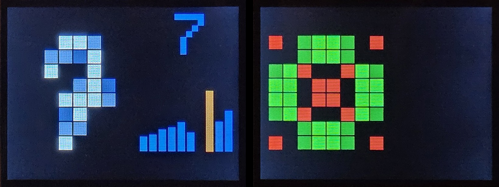
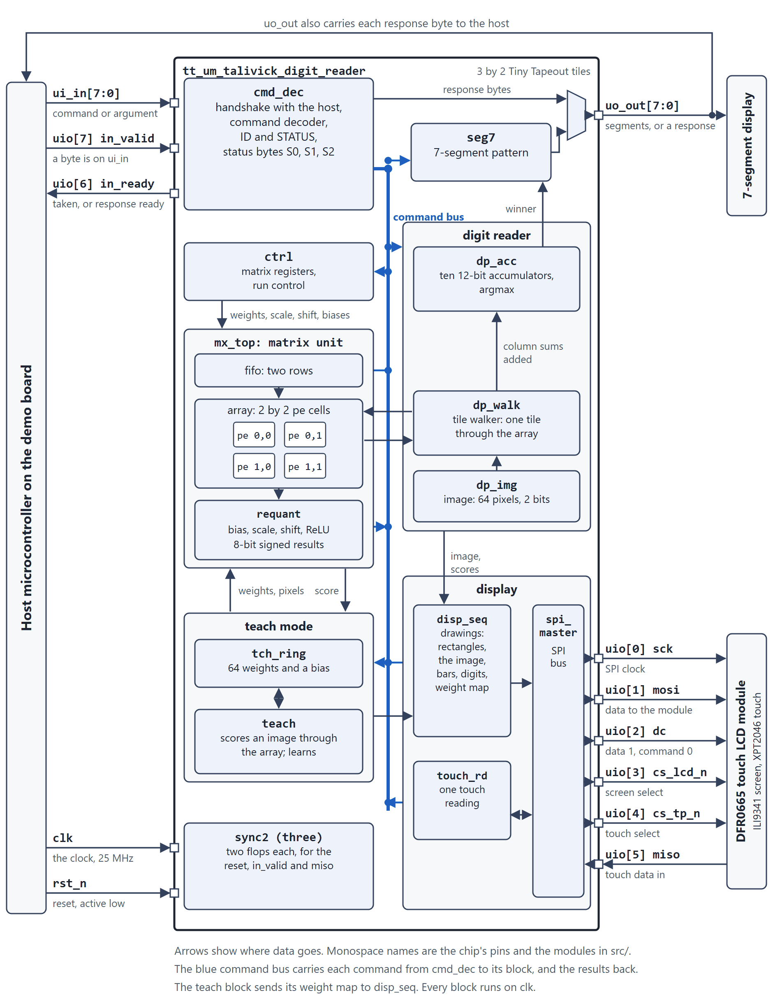

  

# INT8 systolic array coprocessor with on-chip learning and a touch LCD

This chip recognizes patterns. It takes 64 small numbers that describe something, such as a drawn digit or a short
sound, and tells which of up to ten known kinds it is. It can also learn to tell two kinds apart from a few
examples. It is a small example of the kind of chip that runs neural networks, the programs behind image and speech
recognition.

Recognizing a pattern comes down to arithmetic. Take a handwritten digit as the example. A person draws a digit on
a touch screen. The drawing is divided into 8 by 8 squares, and each square gets a number from 0 to 3 for how much
of the drawing falls in it. That gives 64 numbers. For each of the ten digits, 0 to 9, a table holds one more
number for every square, called a weight. A weight is positive when a line in that square counts for the digit and
negative when it counts against the digit. Each square's number is multiplied by its weight. The 64 products are
added, on top of a starting value for that digit called its bias, and the sum is the digit's score. The digit with
the highest score is the answer. Applying weights in this way is called inference. The weights and the biases are
found beforehand on a computer, from example drawings. That step is called training.



The photo shows the design at work before the chip is made. It runs on an FPGA, a chip that can be configured to
behave as the design, with the screen wired to it. On the left the design has read a handwritten 7 from a public
set of example digits. The screen shows the 8 by 8 image, the answer 7 at the top right and the ten scores as bars,
with the winner's bar in a second color. The lowest score is drawn with no bar. On the right the design has learned
to tell a circle from an X from six example images, and the screen shows the 64 weights it learned. A green square
counts for the circle, and a red square counts for the X.

The design was submitted to [Tiny Tapeout](https://tinytapeout.com) in November 2026, for its run named SKY26d.
Tiny Tapeout puts many small designs on one chip, which SkyWater makes in its 130 nm process. The chip is not made
yet, and Tiny Tapeout expects the chips of this run in 2027. The tag `sky26d-submission` marks the submitted
commit.

The chip's datasheet page is [docs/info.md](docs/info.md). It explains how the chip works with drawings, lists the
pins and the timing, and gives the steps to test the chip and to wire the screen. The layout can be turned and
zoomed in the [3D viewer](https://talivick.github.io/tt-digit-reader/).

## What is in the chip

The chip is a small coprocessor for inference and learning. A host microcontroller drives it one byte at a time
over an eight-bit bus with a two-wire handshake, and the chip does the multiplying and adding. At its center is the
matrix unit, a 2 by 2 systolic array of 8-bit signed (INT8) multipliers. A systolic array is a grid of
multiply-accumulate cells that pass their data to their neighbors every clock. A much larger grid of this kind is
at the center of the TPU (tensor processing unit), a chip built to run neural networks in data centers. The matrix
unit follows the TPU's design on a mini scale.

Inside are four parts.

- **The matrix unit** multiplies rows of two 8-bit signed inputs by a held 2 by 2 matrix of weights and adds the
  products of each column. Each column sum is then requantized, which means it is brought back to an 8-bit signed
  value. A bias is added, the sum is multiplied by a scale and shifted right with rounding, and the result is
  limited to -128 to 127. An optional last step, ReLU (rectified linear unit), replaces a negative result with 0.
- **The digit reader** stores an 8 by 8 image of 2-bit pixels and keeps the ten scores in 12-bit signed
  accumulators, each started from its bias. The host sends the 640 weights four at a time. Each four, called a tile
  in the chip map, go through the matrix unit with two pixels, and each of the two column sums is added to one of
  the scores. After the last tile the chip finds the largest score, which the chip map calls argmax, and reports
  the winner and the scores.
- **The teach block** is the chip's learning mode, teach mode in the chip map. It keeps one set of 64 weights and a
  bias, 6 bits each, in a ring of 65 registers, and learns them on the chip. The host sends examples of two kinds,
  such as a circle and an X, each labeled with its kind. The chip scores each example, positive for the first kind
  and negative for the second. When the score is not on the label's side by more than a margin, each weight moves
  toward the label by a step times its pixel's value, and the bias by the step.
- **The display block** drives a touch LCD over SPI. It clears the screen, draws the image, draws ten bars, writes
  digits and reads the touch panel.



Around the four parts are the command decoder, `cmd_dec` in the map, which takes the host's bytes and returns the
responses, and a 7-segment output, which shows the digit that was read. The 7-segment pins also carry each response
byte to the host.

## The numbers

| Item | Value |
|:---|:---|
| Matrix unit | 2 by 2 cells, each holding one 8-bit signed weight in place; 8-bit signed inputs |
| Digit reader input | 64 pixels (8 by 8) of 2 bits |
| Digit reader weights | 640, 4-bit signed, sent by the host; none stored on the chip |
| Biases and accumulators | ten 8-bit signed biases; ten 12-bit signed accumulators |
| Accuracy | 95.83 percent, 345 of 360 images kept aside from training (scikit-learn's public 8 by 8 digit set) |
| Teach block | 64 weights and a bias, 6-bit signed, limited to -31 to 31 |
| Host interface | 27 commands; at most one byte per 7 clocks (280 ns, 3.57 million bytes per second) |
| Clock | 25 MHz (40 ns), one clock for the whole chip |
| Size | 508.76 by 225.76 micrometers, or 3 by 2 Tiny Tapeout tiles, the unit of area a design is given |

## How it was tested

Before tape-out the full chip was tested through its pins, with the host's handshake, on the RTL and again on the
gate-level netlist at the 25 MHz clock. The tests covered reset and the pin levels, the matrix unit, a digit
reading with its drawings, teach mode, the touch read, the commands the chip holds while it is busy, the commands
it refuses and the error flags. The same RTL ran on an FPGA board at 25 MHz with the touch LCD, a DFRobot DFR0665
module, wired to the bidirectional pins. It drew on the screen, read the touch panel, read digits and learned to
tell two symbols apart from six example images, and every matrix result, digit score and teach score it returned
equaled the value from a software model of the same arithmetic.

The repository's own test, `test/test.py`, is a short check that the build runs on the RTL and again on the
gate-level netlist: the pin levels through reset, then the ID command, then the STATUS command twice. The fuller
tests described above, the host's program and the trained weights are not in this repository. To run the short
check, install Icarus Verilog and the Python packages in `test/requirements.txt`, then:

```sh
cd test
make -B
```

## The repository

The sources are in `src/`, by block:

- **The top level and the host's side:** `project.v` (the top level, module `tt_um_talivick_digit_reader`),
  `address_map.sv` (the command codes, the register addresses and the status bits), `cmd_dec.sv` (the command
  decoder).
- **The matrix unit:** `mx_top.sv`, `ctrl.sv` (its control and registers), `array.sv` (the 2 by 2 systolic array),
  `pe.sv` (the processing element, one cell of the array), `mac.sv` (the multiply-accumulate cell), `requant.sv`
  (the requantize unit), `fifo.sv` (the row FIFO).
- **The digit reader:** `dp_img.sv` (the image), `dp_walk.sv` (the tile walker, which runs one tile), `dp_acc.sv`
  (the ten scores and the pick of the largest).
- **The teach block:** `teach.sv` (its control), `tch_ring.sv` (its ring of weights).
- **The display block:** `disp_seq.sv` (the display sequencer), `spi_master.sv` (the SPI master), `touch_rd.sv`
  (the touch reader).
- **Shared:** `seg7.sv` (the 7-segment encoder), `sync2.sv` (the two-flop synchronizer).

`docs/` holds the datasheet page and its pictures. `test/` holds the test bench `tb.v` and the test `test.py`.
`info.yaml` is the project's entry for Tiny Tapeout: the title, the pins and the list of sources.

## License

Apache License 2.0, in [LICENSE](LICENSE). Copyright (c) 2026 Thomas Livick.
