<!---

This file is used to generate your project datasheet. Please fill in the information below and delete any unused
sections.

You can also include images in this folder and reference them in the markdown. Each image must be less than
512 kb in size, and the combined size of all images must be less than 1 MB.
-->

## How it works

This chip recognizes patterns. It takes 64 small numbers that describe something, such as a drawn digit or a short
sound, and tells which of up to ten known kinds it is. It can also learn to tell two kinds apart from a few
examples. It is a small example of the kind of chip that runs neural networks, the programs behind image and speech
recognition.

Recognizing a pattern comes down to arithmetic. Take a handwritten digit as the example. A person draws a digit on
a touch screen. The drawing is divided into 8 by 8 squares, and each square gets a number from 0 to 3 for how much
of the drawing falls in it, 0 for little or none and 3 for the most. That gives 64 numbers. For each of the ten
digits, 0 to 9, a table holds one more number for every square, called a weight. A weight is positive when a line
in that square counts for the digit and negative when it counts against the digit. Each square's number is
multiplied by its weight. The 64 products are added, on top of a starting value for that digit, and the sum is the
digit's score. The digit with the highest score is the answer. Applying weights in this way is called inference.
The weights and the starting values are found beforehand on a computer, from 1,437 example drawings. That step is
called training.

The 64 numbers do not have to come from a drawing. A short sound can be described by how loud it is in eight ranges
of pitch, from low to high, at eight moments in time. That is also 64 numbers. With weights trained on sounds, the
same chip can tell sounds apart.

Reading one digit takes 640 multiplications, 64 for each of the ten digits. A simple processor does them one after
another. This chip has four multipliers side by side in a 2 by 2 grid, so four multiplications are done together.
The numbers move through the grid from one multiplier to the next on every tick of the chip's clock, which ticks 25
million times a second. A grid of this kind is called a systolic array. The grid, with the logic around it, is this
chip's matrix unit. A much larger grid of this kind is at the center of the TPU (tensor processing unit), a chip
built to run neural networks in data centers. The matrix unit follows the TPU's design on a mini scale.

The chip does not work alone. A small computer beside it, called the host, gathers the 64 numbers. The host sends
them to the chip with the weights, a few numbers at a time, and asks for the answer. In the digit demonstration the
host reads the drawing from a touch screen through the chip. On the host's commands the chip draws the 64 squares,
the ten scores as bars and the winning digit on the screen. It also shows the digit on a 7-segment display, a
number display made of seven bars. The chip has a small learning mode of its own as well. Given a few examples of
two kinds, such as circles and crosses, each marked with its kind, it adjusts 64 weights of its own until it tells
the two apart.

### The chip

The chip is a small coprocessor for inference and learning. A host microcontroller drives it one byte at a time
over an eight-bit bus with a two-wire handshake, and the chip does the arithmetic a small classifier needs. At its
center is a matrix unit, a 2 by 2 systolic array of 8-bit signed (INT8) multipliers with accumulators and a
requantization stage.

Inside are four parts. A 2 by 2 systolic matrix unit multiplies rows of two activations by a held 2 by 2 weight
matrix and requantizes each result to an 8-bit signed value with a bias, a scale, a rounding shift and ReLU. A
digit reader stores a 64-pixel 2-bit image, walks it through the matrix unit tile by tile against 640 weights,
keeps ten 12-bit accumulators and reports the best class. A teach block learns a two-class rule from examples the
host labels and scores an image against it. It keeps 64 weights and a bias, 6 bits each, in a ring of 65 registers.
A display block drives a touch LCD over SPI. It clears the screen, draws the image, draws ten bars, writes digits
and reads the touch panel.

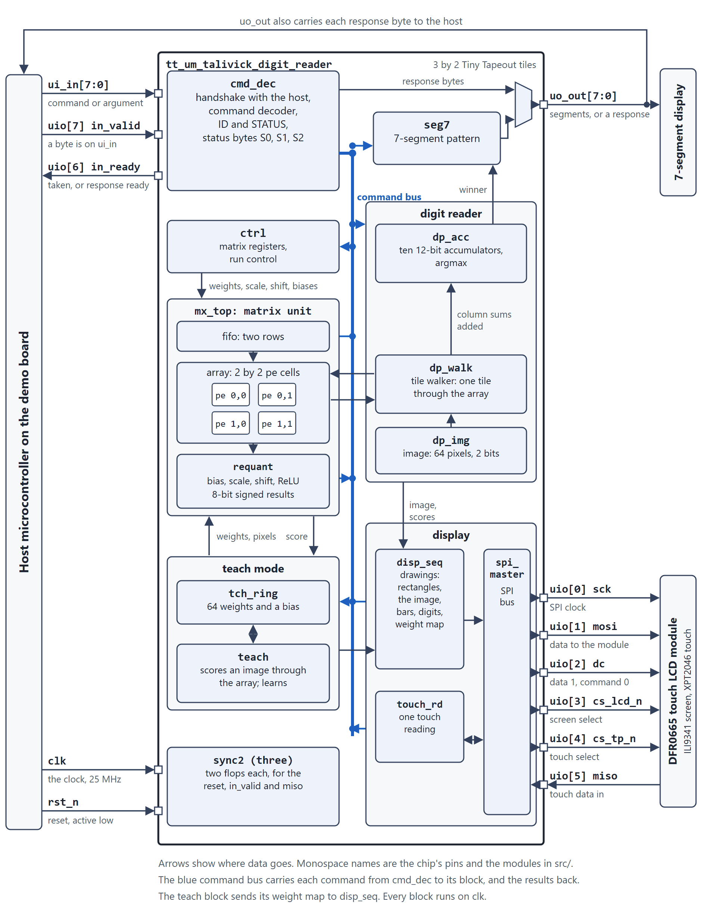

The chip map above shows the pins on the edge of the chip, the blocks by their module names in src/, and what
passes between them. Every block runs on the one 25 MHz clock.

### The matrix unit

A systolic array is a grid of multiply-accumulate cells that pass their data to their neighbors every clock. In
this one each of the four cells holds one 8-bit signed (INT8) weight, and the inputs that the weights multiply are
called activations. An activation moves one cell to the right each clock and a partial sum moves one cell down, so
each of the two columns adds its two products as the data pass. The host sends a row of two 8-bit signed
activations with MX_ROW, and the row waits in a FIFO of two rows.

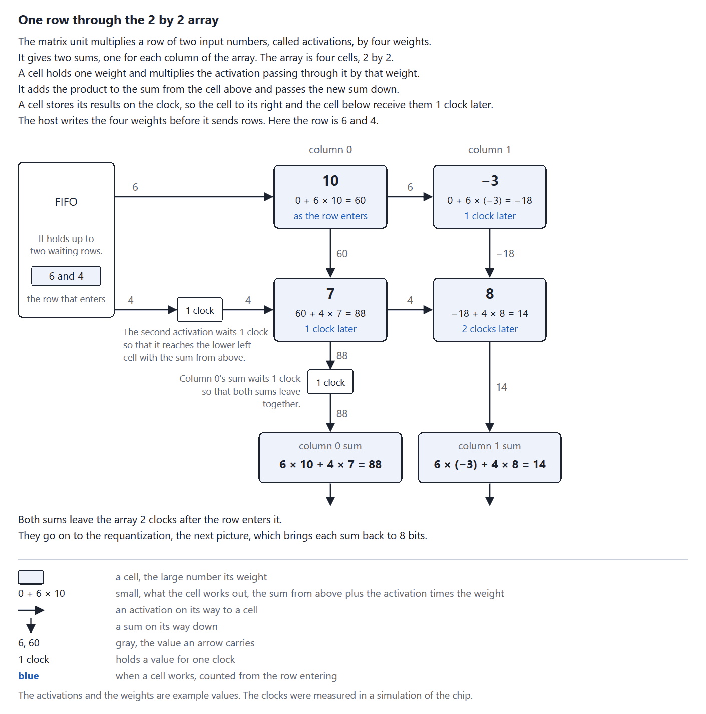

Each 17-bit signed column sum is then requantized, which means it is brought back to an 8-bit signed value. First a
bias is added to the column sum. Each column has its own 17-bit signed bias. Next the sum is multiplied by a factor
that the host chooses. The chip works in whole numbers only, so the host gives the factor as two whole numbers, a
16-bit unsigned scale and a shift S of 0 to 31. The chip multiplies the sum by the scale and then shifts the
product right by S bits, which divides it by 2 to the power S. A scale of 3 and a shift of 2 give the factor 3/4,
so a sum of 100 becomes 75. The division rounds half up, and the result is limited to -128 to 127. The last step is
optional. It is called ReLU (rectified linear unit), and it replaces a negative result with 0.

One requantization unit serves both columns, one after the other. For each column it multiplies by one bit of the
scale per clock, which takes 16 clocks, and then shifts by one bit per clock, which takes S clocks. With both
columns counted, a result is ready 37 + 2S clocks after its row enters the array. The count is 2 clocks in the
array, 1 clock to start, and for each of the two columns 16 clocks to multiply, S to shift and 1 to store the
result. That is 37 clocks at a shift of 0 and 99 clocks at a shift of 31. The host writes the weights, the biases,
the scale, the shift and the ReLU enable as registers, and reads the two results of each row with MX_READ.

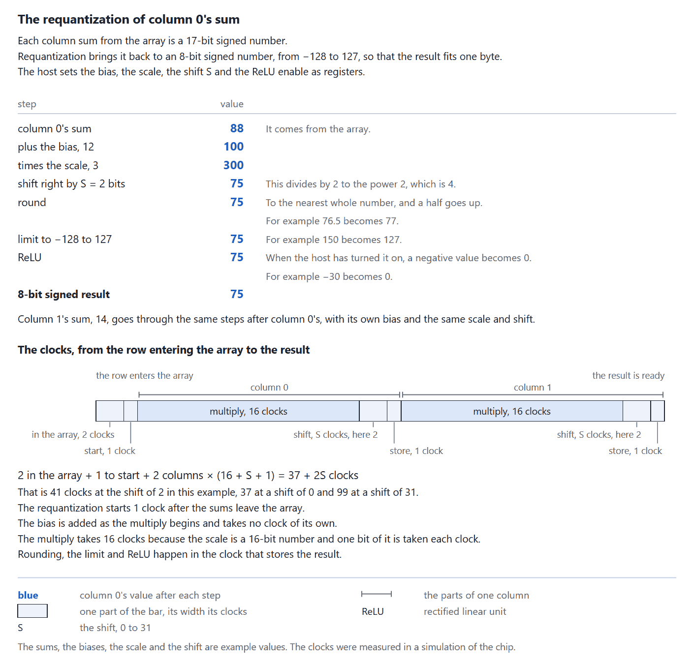

### The digit reader

The digit reader works out ten scores with the matrix unit's array, one for each of ten classes. A class is one of
the ten answers a reading can give. In the demonstration the ten classes are the ten digits, so class 4 is the
digit 4. A class's score is its bias plus the sum of 64 products, each input multiplied by the weight that class
has for it. The bias is the score the class has when every input is 0. The class with the largest score wins. This
arithmetic is called a linear classifier. The digit reader is named for its demonstration, an 8 by 8 image of a
handwritten digit, but the 64 inputs can be any 2-bit values.

The host does one reading with five commands. The pictures between the steps follow the first four with example
numbers.

1. DIG_START brings the ten biases, one for each class. A bias is the value a class's score starts from. Training
   gives the biases together with the weights, and the host sends them at the start of every reading. The ten
   scores are held in ten 12-bit signed accumulators, and each starts at its class's 8-bit signed bias.
2. IMG brings the image, the 64 pixel values of 0 to 3 that the host has made. It arrives as 16 bytes, four 2-bit
   pixels to a byte, in the bit order given under How to test. The chip keeps it in a ring, a loop of 16 byte
   registers in which the bytes step around past the one place where they are read.

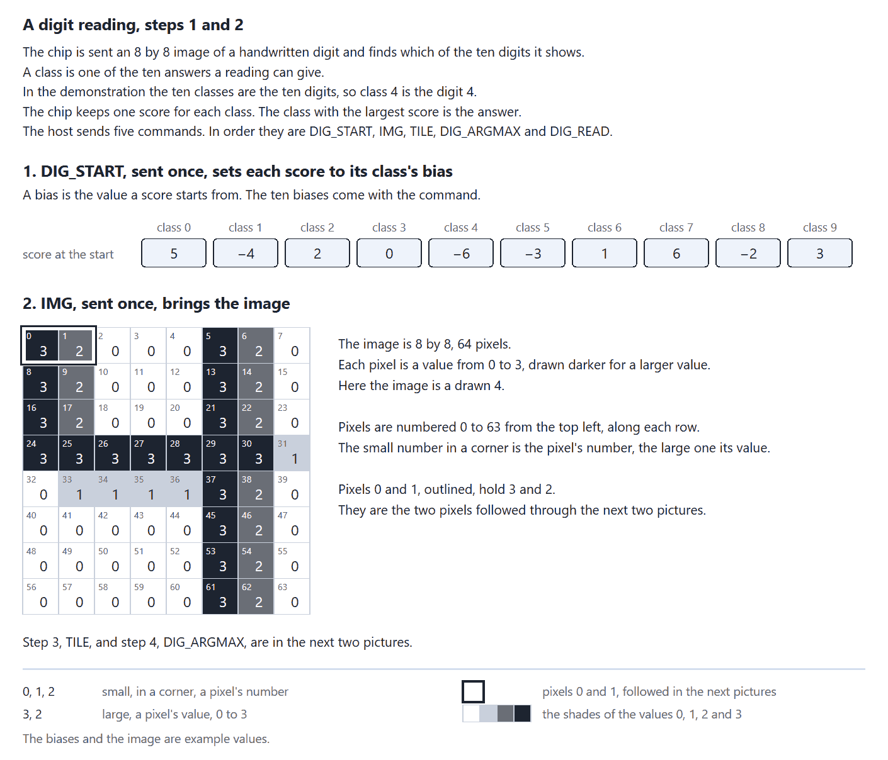

3. TILE brings four weights, and the host sends it 160 times. There are 640 weights, one for each of the 64 pixels
   in each of the ten classes, and each is a 4-bit signed number from -8 to 7. The chip does not store them, which
   saves 2,560 bits of storage. The host sends them four at a time, and four weights that fill the 2 by 2 array
   once are called a tile. A tile holds the weights of two pixels for two classes. The chip loads the tile into the
   array and sends the two pixels through it as one row. Each of the two column sums is then the share of those two
   pixels in one class's score, and the chip adds it to that score as it is, without the requantization. TILE
   carries no tile number. The chip counts the tiles from DIG_START on, so the host sends all 160 in a fixed order.
   Tiles 0 to 4 take pixels 0 and 1 through the five pairs of classes, which are 0 and 1, 2 and 3, 4 and 5, 6 and
   7, and 8 and 9. Tile 5 starts on pixels 2 and 3, and so on. One reading takes 160 tiles, 32 pairs of pixels by 5
   pairs of classes.

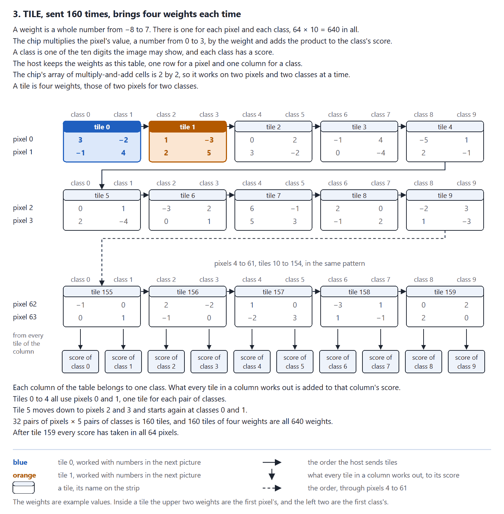

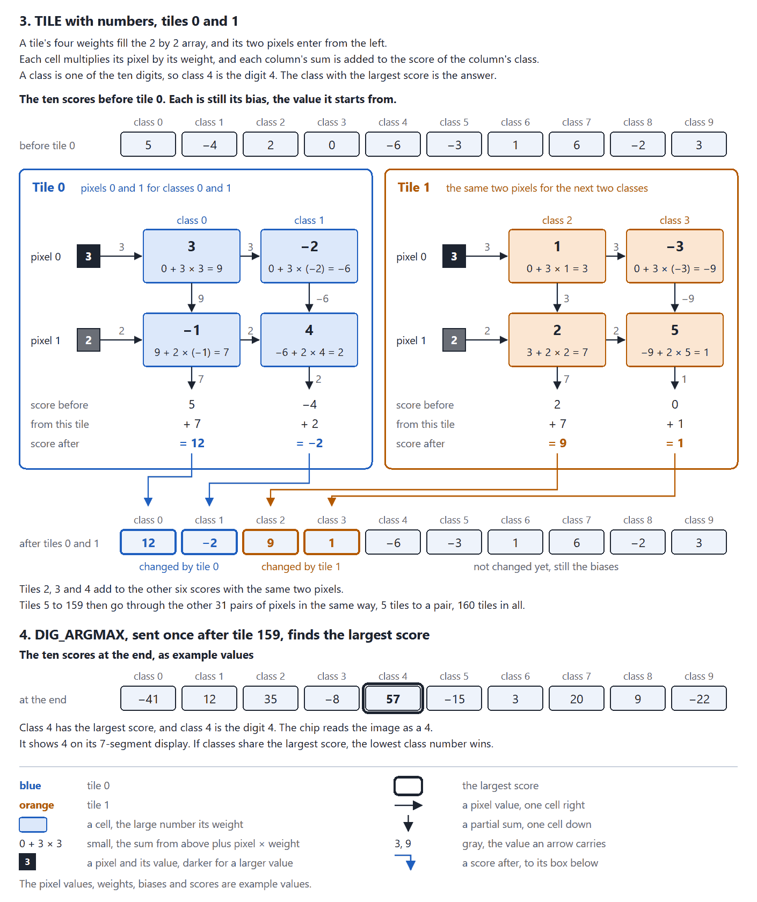

4. DIG_ARGMAX follows the last tile. The chip finds the class with the largest score and shows its number on the
   7-segment display. When classes share the largest score, the lowest class number wins.
5. DIG_READ returns the answer to the host, the winner and then the ten scores.

Twelve bits are enough for a score. A pixel is at most 3 and a weight lies in -8 to 7, so the 64 products add up to
between -1,536 and 1,344. With an 8-bit signed bias a score stays within -1,664 to 1,471, inside the 12-bit signed
range of -2,048 to 2,047.

The weights of the demonstration were trained with scikit-learn, an open source machine learning library for
Python, on its set of 1,797 handwritten digits of 8 by 8 pixels. Of these, 1,437 images were used for training. The
other 360 were kept aside to test the result. A pixel of the set is a value from 0 to 16, and it is reduced to 2
bits. Training gives weights with fractions. Every weight is divided by one common divisor, chosen so that the
largest weight becomes 7, and rounded to a 4-bit whole number. The biases are brought to the same units and rounded
to 8-bit signed whole numbers. With these whole numbers, in the same arithmetic the chip uses, the model reads 345
of those 360 images correctly, which is 95.83 percent. Because all ten classes share the one divisor, every score
is the trained model's score multiplied by the same number, apart from the rounding, and the ten scores can be
compared as they are. The divisor is used once, when the whole numbers are made, and the chip never needs it.

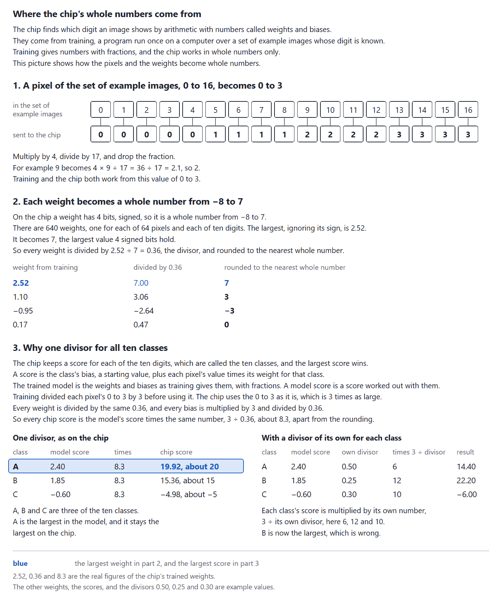

The host sees registers, commands and three status bytes, all listed in src/address_map.sv. With the digit reader
and the teach block the chip classifies and learns from any 64 inputs of 2 bits.

The chip holds the matrix unit, the digit reader, the teach block and the display, with the command decoder, the
handshake and the 7-segment output. Parameters in src/project.v can leave blocks out of a build, and the ID command
reports which blocks a chip has.

### The numbers

| Item | Value |
|:---|:---|
| Matrix unit | 2 by 2 cells, each holding one 8-bit signed weight in place; 8-bit signed activations |
| Column sum | 17-bit signed, since two products of -128 by -128 reach 32,768, one more than 16 bits signed hold |
| Requantization | 17-bit signed bias, 16-bit unsigned scale, shift 0 to 31, 8-bit signed result, ReLU on or off |
| Matrix result | 37 + 2S clocks after its row enters the array, S being the shift (37 to 99 clocks) |
| Row FIFO | 2 rows; a host with at most 3 rows sent and not yet read back never overfills it |
| Digit reader input | 64 pixels (8 by 8) of 2 bits, in 16 bytes |
| Pixel values | a pixel x of the example set, 0 to 16, is sent as 4x / 17 without its fraction, 0 to 3 |
| Digit reader weights | 640, 4-bit signed, sent by the host as 160 tiles of four; none stored on the chip |
| Biases and accumulators | ten 8-bit signed biases; ten 12-bit signed accumulators |
| Bytes of one reading | 531 on the handshake, responses included |
| The 531 bytes | 11 for DIG_START, 17 for IMG, 480 for 160 TILE commands, 1 for DIG_ARGMAX, 22 for DIG_READ |
| Accuracy | 95.83 percent, 345 of the 360 images kept aside (scikit-learn's 8 by 8 digits, 1,437 for training) |
| Teach weights | 64 weights and a bias, 6-bit signed, limited to -31 to 31; 14-bit signed score |
| Teach step | a weight changes by the step times its pixel's value; 0 to 15 (1 after a reset) |
| Teach margin | no change when the score is past the margin on the label's side; 0 to 8,191 (124 after a reset) |
| Commands, registers | 27 commands; 23 register bytes, written and never read back; 3 status bytes |
| Handshake | at most one byte per 7 clocks on the chip's side (280 ns, 3.57 million bytes per second) |
| SPI clock after a reset | 6.25 MHz to the screen, 1.5625 MHz to the touch controller |
| Full-screen clear | 196.62 ms for 320 by 240 pixels of 16 bits at the SPI clock after a reset |
| Clock | 25 MHz (40 ns), one clock for the whole chip |
| Size | 508.76 by 225.76 micrometers, or 3 by 2 Tiny Tapeout tiles, the unit of area a design is given |

### Pins

| PIN | NAME | FUNCTION | DESCRIPTION | RESET |
|:---|:---|:---|:---|:---:|
| clk | clk | Digital input | Clock, 25 MHz | |
| rst_n | rst_n | Digital input | Reset; asynchronous; active low | |
| ena | ena | Digital input | Design enable; not used | |
| ui[7:0] | host byte | Digital input | Command or argument byte, or 0x00 to read a response | |
| uo[5:0] | seg f to a | Digital output | Segments f to a, or response byte bits 5 to 0 | 0 |
| uo[6] | seg g | Digital output | Segment g, or response byte bit 6 | 1 |
| uo[7] | seg dp | Digital output | Decimal point, or response byte bit 7 | 0 |
| uio[0] | sck | Digital output | SPI clock | 0 |
| uio[1] | mosi | Digital output | SPI data output | 0 |
| uio[2] | dc | Digital output | Screen data or command select; 0 for a command, 1 for data | 1 |
| uio[3] | cs_lcd_n | Digital output | Screen chip select; active low | 1 |
| uio[4] | cs_tp_n | Digital output | Touch controller chip select; active low | 1 |
| uio[5] | miso | Digital input | SPI data input from the touch controller | |
| uio[6] | in_ready | Digital output | Handshake output; high when a byte is taken or a response is valid | 0 |
| uio[7] | in_valid | Digital input | Handshake input; high to send a byte or read a response byte | |

All flip-flops are clocked on the rising edge of clk. Every output takes its reset level when rst_n falls, and the
output levels are undefined until the first reset. The chip leaves reset on the second rising edge of clk after
rst_n rises, or on the third when rst_n rises within the recovery window of a clock edge.

The segment outputs are active high. uo_out carries a response byte only during the handshake that reads it. The
serial bus is SPI mode 0, MSB first. uio_oe is the constant 0x5F, in reset too.

in_valid and miso are asynchronous inputs, each synchronized by two flip-flops. ui_in is not synchronized. It is
sampled once per byte, one clock period before in_ready rises.

### Timing

All times are in clock periods, tCLK = 40 ns at fCLK = 25 MHz. They were taken from a simulation of the RTL at the
pins and do not include pad or board delays. in_valid is asynchronous to clk, so a delay referenced to an edge of
in_valid spans one clock period. Its limits were found by sweeping the edge across one period in 20 steps.

#### Timing Requirements

| SYMBOL | PARAMETER | MIN | MAX | UNIT |
|:---|:---|:---:|:---:|:---:|
| td(RSIV) | Delay time, in_valid rising edge after rst_n rising edge | 4 |  | tCLK |
| tsu(UI) | Setup time, ui_in valid before in_valid rising edge | 0 |  | tCLK |
| th(UI) | Hold time, ui_in valid after in_ready rising edge | 0 |  | tCLK |
| th(IV) | Hold time, in_valid high after in_ready rising edge | 0 |  | tCLK |
| td(IRIV) | Delay time, in_valid rising edge after in_ready falling edge | 0 |  | tCLK |
| tsu(MI) | Setup time, miso valid before sck falling edge | 2 |  | tCLK |

tsu(MI) applies to the touch controller. All other requirements apply to the host.

#### Switching Characteristics

Handshake

| SYMBOL | PARAMETER | MIN | MAX | UNIT |
|:---|:---|:---:|:---:|:---:|
| td(UIIR) | Delay time, clk rising edge that samples ui_in to in_ready rising edge | 1 | 1 | tCLK |
| td(IVH) | Delay time, in_valid rising edge to in_ready rising edge | 3 | 4 | tCLK |
| td(IVL) | Delay time, in_valid falling edge to in_ready falling edge | 2 | 3 | tCLK |
| td(UOIR) | Delay time, response byte valid on uo_out to in_ready rising edge | 1 | 1 | tCLK |
| td(IVUO) | Delay time, in_valid falling edge to response byte invalid on uo_out | 2 | 3 | tCLK |
| tc(BYTE) | Cycle time, in_ready rising edge to the next in_ready rising edge | 7 |  | tCLK |

Serial bus

The SCKDIV register (address 0x04, written with REG_WR) sets the half period of sck. Bits 3 to 0 hold the screen's
half period in tCLK minus 1, and bits 7 to 4 the touch controller's. The reset value 0x71 gives 2 tCLK to the
screen (6.25 MHz) and 8 tCLK to the touch controller (1.5625 MHz). Both tables give the values at the reset value.
A frame is the interval in which one select is low.

Screen frames. Select is cs_lcd_n.

| SYMBOL | PARAMETER | MIN | MAX | UNIT |
|:---|:---|:---:|:---:|:---:|
| td(IRCS) | Delay time, in_ready rising edge of the last byte to select falling edge (1) | 1 | 1 | tCLK |
| td(CSSC) | Delay time, select falling edge to first sck rising edge | 2 | 2 | tCLK |
| tc(SC) | Cycle time, sck | 4 | 4 | tCLK |
| tw(SCH) | Pulse duration, sck high | 2 | 2 | tCLK |
| tw(SCL) | Pulse duration, sck low | 2 | 2 | tCLK |
| tsu(DC) | Setup time, dc valid before the first sck rising edge of a byte | 2 | 2 | tCLK |
| tsu(MO) | Setup time, mosi valid before sck rising edge | 2 |  | tCLK |
| th(MO) | Hold time, mosi valid after sck rising edge | 2 |  | tCLK |
| td(SCCS) | Delay time, last sck falling edge to select rising edge | 2 | 2 | tCLK |
| tw(CSL) | Pulse duration, select low, one screen byte or one touch read | 34 | 34 | tCLK |

(1) With no td(GUARD) wait before the frame. A td(GUARD) wait adds to this delay.

Touch frames. Select is cs_tp_n, and dc is high throughout the frame.

| SYMBOL | PARAMETER | MIN | MAX | UNIT |
|:---|:---|:---:|:---:|:---:|
| td(IRCS) | Delay time, in_ready rising edge of the last byte to select falling edge (1) | 1 | 1 | tCLK |
| td(CSSC) | Delay time, select falling edge to first sck rising edge | 8 | 8 | tCLK |
| tc(SC) | Cycle time, sck | 16 | 16 | tCLK |
| tw(SCH) | Pulse duration, sck high | 8 | 8 | tCLK |
| tw(SCL) | Pulse duration, sck low | 8 | 8 | tCLK |
| tsu(MO) | Setup time, mosi valid before sck rising edge | 8 |  | tCLK |
| th(MO) | Hold time, mosi valid after sck rising edge | 8 |  | tCLK |
| td(SCCS) | Delay time, last sck falling edge to select rising edge | 8 | 8 | tCLK |
| tw(CSL) | Pulse duration, select low, one screen byte or one touch read | 392 | 392 | tCLK |

(1) With no td(GUARD) wait before the frame. A td(GUARD) wait adds to this delay.

Touch read

| SYMBOL | PARAMETER | MIN | MAX | UNIT |
|:---|:---|:---:|:---:|:---:|
| td(SCIR) | Delay time, last sck falling edge to in_ready rising edge for the response | 3 | 3 | tCLK |
| td(READ) | Delay time, in_ready rising edge, control byte to response (1) | 388 | 388 | tCLK |
| td(GUARD) | Delay time, both selects high before a select falling edge (2) | 5,056 | 5,056 | tCLK |

(1) With no td(GUARD) wait before the frame. A td(GUARD) wait adds to this delay.

(2) At the reset value of GUARD.

#### Reset

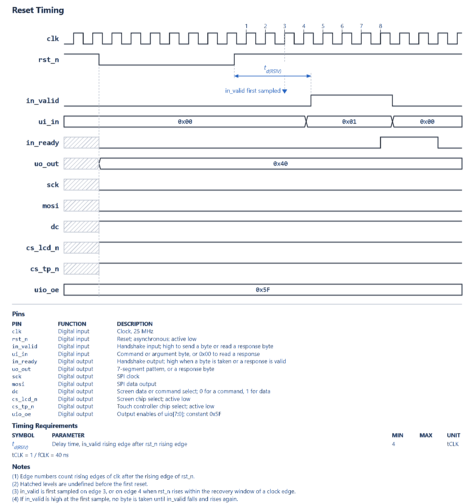

After the rising edge of rst_n, the host keeps in_valid low for td(RSIV) before it sends the first byte. The chip
samples in_valid for the first time on the third rising edge of clk after rst_n rises, or on the fourth when rst_n
rises within the recovery window of a clock edge. If in_valid is high at that sample, no byte is taken until
in_valid has gone low and high again. A minimum low time of rst_n is not specified.

#### Host Write

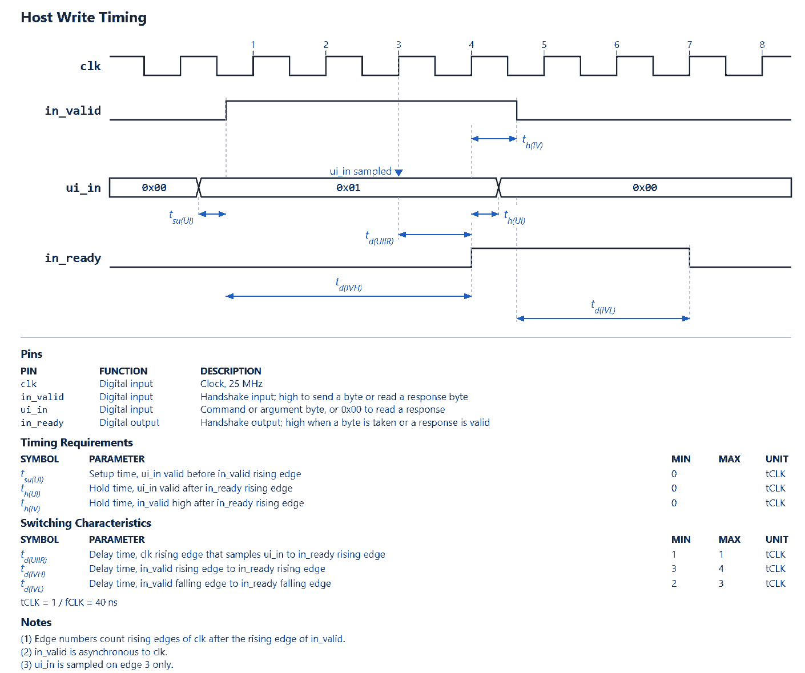

The host holds in_valid high until in_ready rises, and low until in_ready falls. td(IVH) applies when the chip
takes the byte at once. A command byte other than NOP, ID, STATUS and CLR_ERR is held while DISP_BUSY or WALK_BUSY
is set in status byte S0. A command byte sent during a PT_CMD frame is taken when the frame ends, and in_ready
rises 5 tCLK after cs_lcd_n rises.

#### Host Read

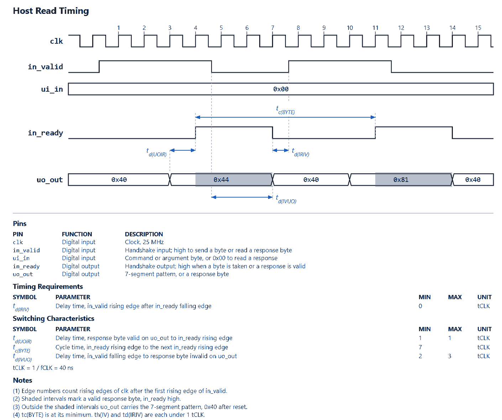

uo_out returns to the 7-segment pattern on the clock edge on which in_ready falls. tc(BYTE) is at its minimum when
th(IV) and td(IRIV) are each under one clock period, which gives 3.57 million bytes per second.

#### Serial Bus

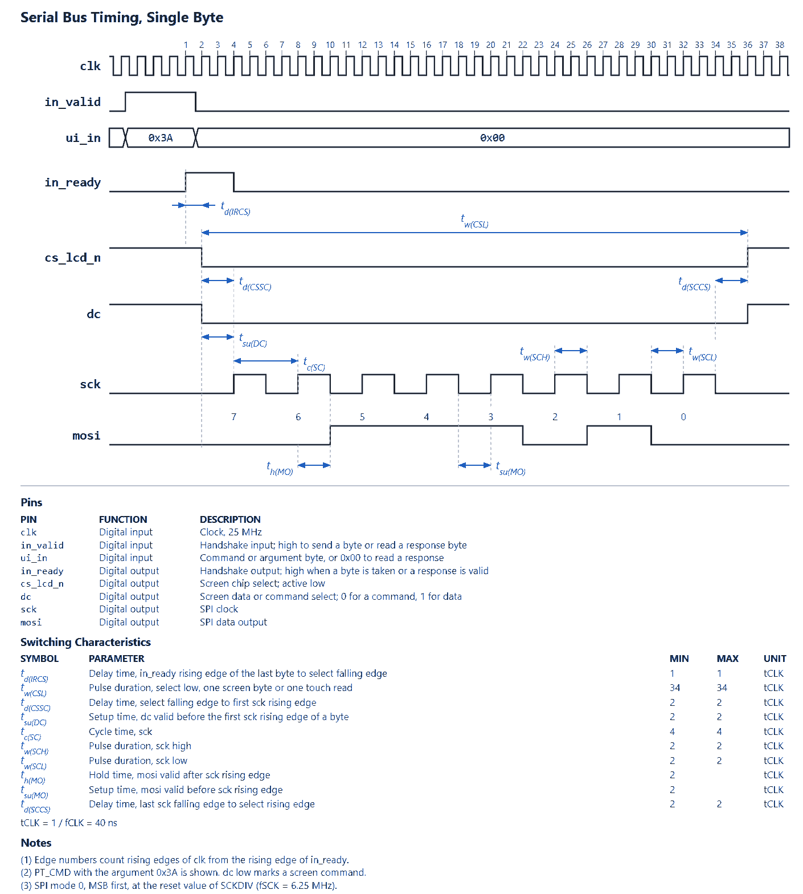

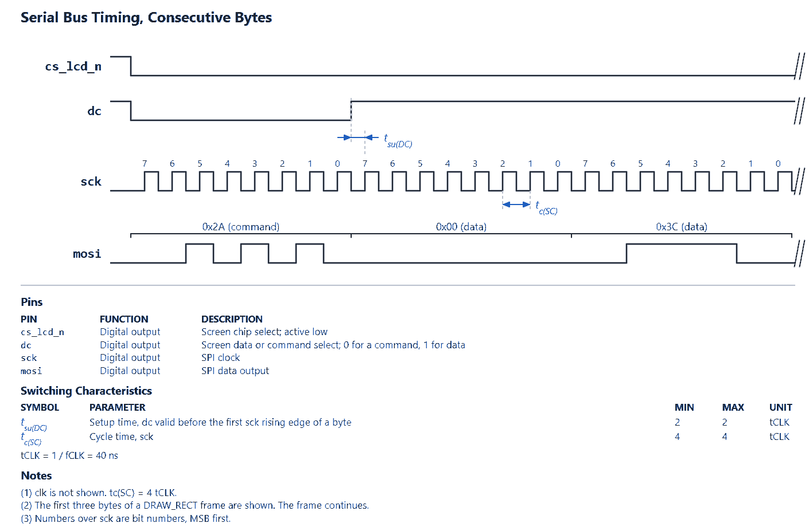

PT_CMD and PT_DAT each send a frame of one byte. A drawing
command such as DRAW_RECT sends one frame of many bytes with no pause between the bytes. mosi changes on the
falling edge of sck, and dc changes with the first bit of a byte. At the end of a frame the select rises, and on
the same clock edge mosi returns to 0 and dc to 1. td(IRCS) applies to the last byte of PT_CMD, PT_DAT and TP_READ.

#### Touch Read

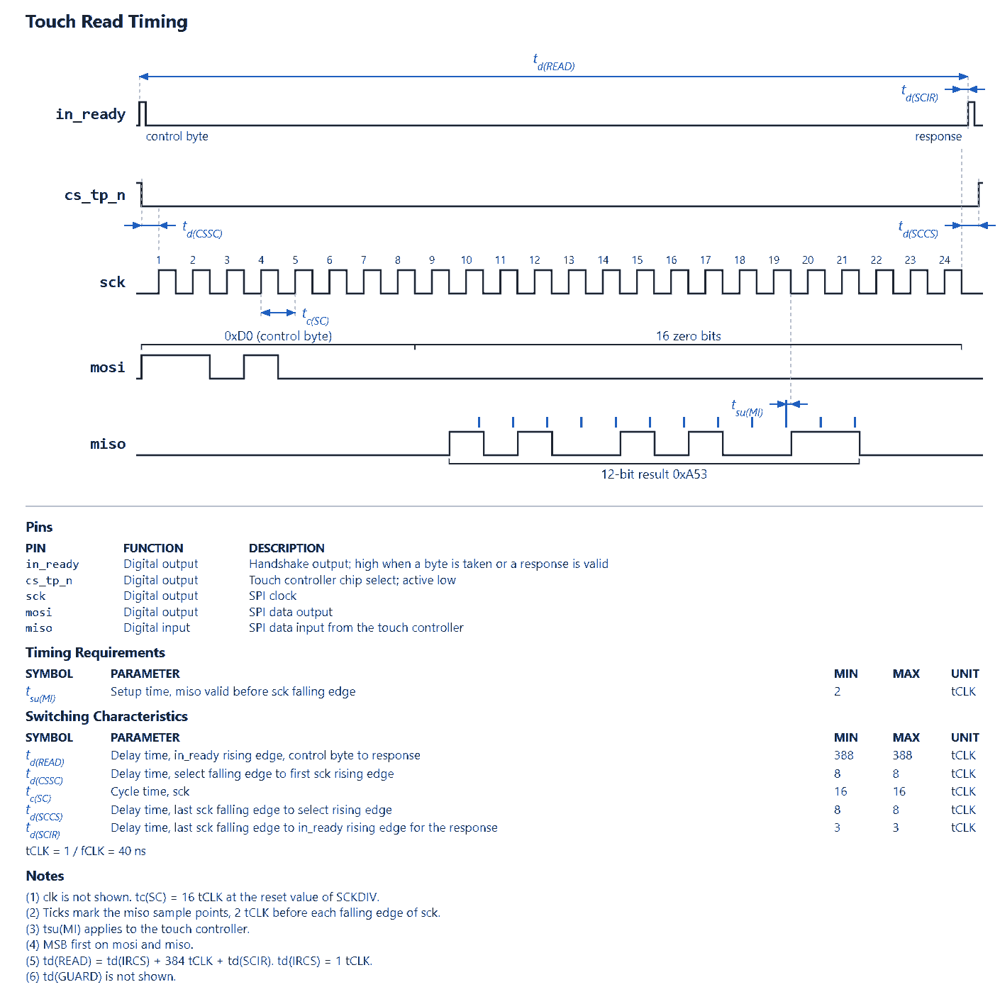

TP_READ takes the control byte as its argument and sends one frame of 24 sck cycles, the control byte followed by
16 zero bits, with dc at 1. The touch controller returns one zero bit in cycle 9 and the 12-bit result in cycles 10
to 21, MSB first. The chip samples miso once per cycle, 2 tCLK before the falling edge of sck, which sets tsu(MI).
The setup time of the chip's input flip-flop is not included. The result is returned in two response bytes, bits
11 to 8 in the low half of the first and bits 7 to 0 in the second.

td(GUARD) is a wait with both selects high before a frame. It is inserted after a reset and before a frame to the
other device, because a select on the DFR0665 module returns high slowly. It is the GUARD register (address 0x05)
times 64 tCLK, 5,056 tCLK at the reset value 0x4F. A touch read that follows a screen frame returns its first
response byte after 5,444 tCLK, td(READ) plus td(GUARD).

## How to test

Hold rst_n low, then release it. The 7-segment display shows segment g alone.

Send a byte: put it on ui_in, raise in_valid (uio[7]) and hold both until in_ready (uio[6]) rises, then drop
in_valid and wait for in_ready to fall. A command is one byte, followed by its argument bytes the same way.
A response byte is read with the same handshake while ui_in holds 0x00: the byte appears on uo_out while
in_ready is high. The command codes, the register addresses and the status bits are in src/address_map.sv.

| Phase | Host | Chip |
|:---|:---|:---|
| 1 | puts the byte on ui_in (0x00 to read a response), raises in_valid | |
| 2 | holds ui_in and in_valid | takes the byte or puts the response on uo_out, raises in_ready |
| 3 | sees in_ready high, reads uo_out for a response, lowers in_valid | |
| 4 | waits for in_ready low before the next byte | lowers in_ready; uo_out returns to the 7-segment pattern |

in_ready rises 3 to 4 clocks after in_valid rises and falls 2 to 3 clocks after in_valid falls, unless the chip
holds the byte while earlier work finishes (in S0, DISP_BUSY while a drawing goes out and WALK_BUSY while a tile is
in the array). After a reset the chip takes no byte until it has seen in_valid low, so the host keeps in_valid low
for at least 4 clocks after rst_n rises.

Send ID. The response is the constant 0x44, then 0x81. Bit 7 is 1 because teach mode is built. Bit 6 is reserved
for a mode that this chip does not have, and it is 0. The low six bits hold form code 1, the digit reader with the
display.

Run the matrix unit: write MX_M, the row count, and the scale, shift, biases and four weights with REG_WR (the
address byte, then the data byte); send MX_START; send MX_ROW with two activation bytes per row, keeping at most
three rows written and not yet read, two before MX_START; read each result with MX_READ, which returns a valid flag
and two 8-bit signed result bytes, and read again when the flag is 0. STATUS returns the three status bytes, S0, S1
and S2: busy, done, the result flag and the FIFO count in the first, the error flags in the second, the digit
reader's answer in the third.

Read a digit: send DIG_START with ten 8-bit signed biases, class 0 first; IMG with sixteen bytes, the 8 by 8 image
at 2 bits per pixel, byte k holding pixels 4k to 4k + 3 with pixel 4k + j in bits 2j + 1 and 2j, pixel p on row p
div 8 and column p mod 8, row 0 at the top and column 0 at the left; then 160 TILE commands, each the four 4-bit
weights of one 2 by 2 tile as {w01, w00} then {w11, w10}, the first of each pair in the high four bits, w_rc being
the weight of pixel 2i + r for class 2j + c, for tile t with i = t div 5 and j = t mod 5; then DIG_ARGMAX, which
picks the class with the largest accumulator and puts it on the 7-segment display. DIG_READ returns S2, with
WIN_VALID in bit 7 and the winner in bits 3 to 0, then the ten accumulators, high byte first. The 640 weights and
the ten biases are the host's, from a model trained on 8 by 8 digits; the chip stores none of them. TILE loads the
array's four weight registers, and so do TCH_SCORE and TCH_LEARN, so write the matrix unit's weights again before
the next MX_START.

| Order | Command | Code | Bytes sent after the code | Bytes returned | What it does |
|:---|:---|:---|:---|:---|:---|
| 1 | DIG_START | 0x30 | 10, the 8-bit signed biases, class 0 first | 0 | sets the ten accumulators to the biases |
| 2 | IMG | 0x31 | 16, the image at 2 bits per pixel | 0 | stores the image |
| 3 | TILE, 160 times | 0x32 | 2, {w01, w00} then {w11, w10} | 0 | adds one tile's two column sums |
| 4 | DIG_ARGMAX | 0x33 | 0 | 0 | picks the winner and shows it on the 7-segment display |
| 5 | DIG_READ | 0x34 | 0 | 21, S2 then the ten accumulators | returns the winner and the scores |

Teach a two-class rule: TCH_CLEAR zeroes the weights and the bias. For each example send IMG, then TCH_LEARN with
the label in bit 0 (0 for the first symbol, 1 for the second). The chip scores the image. The score is the bias
plus the sum of each pixel's value times its weight, positive for the first symbol and negative for the second.
When the score is on the label's side by more than the margin, nothing changes. Otherwise each weight moves toward
the label by the step times its pixel's value, and the bias by the step. TCH_READ returns the score of the last
image, high byte first, then LEARNED (1 when the weights changed) and the bias; repeat the examples until LEARNED
is 0 for every one. TCH_SCORE scores an image without learning. The step is REG_WR register 0x1E (reset 1) and the
margin is registers 0x1F and 0x20 (reset 124). TCH_MAP draws the weights on the LCD.

Drive the LCD: PT_CMD and PT_DAT send one byte to the ILI9341 with dc 0 and 1, so the panel's startup is PT_CMD
0x01 (software reset) and PT_CMD 0x11 (sleep out), each followed by a 120 ms wait, then PT_CMD 0x3A with PT_DAT
0x55 (16-bit pixels), PT_CMD 0x36 with PT_DAT 0x28 (320 by 240, landscape) and PT_CMD 0x29 (display on).
DRAW_RECT takes X, Y, W, H as two bytes each (bit 8 in the first byte's bit 0, bits 7 to 0 in the second) and a
16-bit RGB565 color, high byte first; DRAW_IMG draws the stored image as blocks, DRAW_BARS the ten accumulators,
DRAW_DIGIT one digit and TCH_MAP the teach weights, with their byte layouts in src/disp_seq.sv, part 1. S0 bit 0,
DISP_BUSY, is 1 while a drawing goes out; a 320 by 240 clear takes 197 ms at the reset SPI dividers. TP_READ with
an XPT2046 control byte (0xD0 for X, 0x90 for Y, 0xB0 for Z1, 0xC0 for Z2) returns the 12-bit conversion in two
bytes, the high four bits first.

test/test.py is the test the flow runs on the RTL and again on the gate-level netlist: the pin levels through
reset, then ID, then STATUS twice. The block tests stay out of this repository.

Before tape-out the full chip was tested through its pins, with the host's handshake, on the RTL and again on the
gate-level netlist at the 25 MHz clock. The tests covered reset and the pin levels, the matrix unit, a digit
reading with its drawings, teach mode, the touch read, the held and refused commands and the error flags. The same
RTL ran on an FPGA board at 25 MHz with the DFR0665 module wired to the bidirectional pins. It drew on the screen,
read the touch panel, read digits and learned to tell two symbols apart from six example images, and every matrix
result, digit score and teach score it returned equaled the software model.

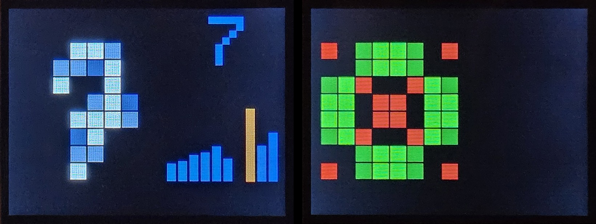

The photo shows the screen in two states. The left half shows it after one digit reading, with the 8 by 8 image in
four levels from black for 0 to white for 3, the winner 7 at the top right and the class scores as bars, the
winner's bar in a second color. For the bars the host adds one value to all ten biases so that the lowest score is
0, and that class shows no bar. The right half shows it after the chip learned a circle as the first symbol and an
X as the second from six example images. TCH_MAP has drawn the 64 weights, one per square of the image. A positive
weight is green and means that ink in that square counts for the circle. A negative weight is red and means that
ink there counts for the X. A zero weight is black. The ring of the circle shows in green and the two lines of the
X in red, with gaps where they cross the ring.

## External hardware

A DFRobot DFR0665 2.8 inch touch LCD (ILI9341 and XPT2046 on one SPI bus) on the bidirectional pins, and a
host on the Tiny Tapeout demo board. The matrix unit alone needs no external hardware.

| Chip pin | Direction | Pmod pin | Module pin | What it carries |
|:---|:---|:---|:---|:---|
| uio[0] sck | out | 1 | 3 CK | SPI clock, mode 0, low when idle |
| uio[1] mosi | out | 2 | 4 SI | data to the screen and the touch controller |
| uio[2] dc | out | 3 | 8 DC | 1 for screen data, 0 for a screen command |
| uio[3] cs_lcd_n | out | 4 | 6 CS | screen select, active low |
| uio[4] cs_tp_n | out | 7 | 10 TC | touch controller select, active low |
| uio[5] miso | in | 8 | 5 SO | data from the touch controller |
| uio[6] in_ready | out | 9 | none | handshake to the host, high when the byte is taken or the response is ready |
| uio[7] in_valid | in | 10 | none | handshake from the host, high while a byte is on ui_in |

The Pmod pin is the pin of the demo board's bidirectional Pmod socket, whose pins 5 and 11 are ground and 6 and 12
are 3.3 V. The module pin is the pin's number on the module's 12-pin header and its mark on the board. The
module's other pins:

- 1 V: the supply, 3.3 V. The module takes 3.3 V to 5.5 V and draws 43.5 mA.
- 2 G: ground.
- 7 RT: the screen's reset, active low. The chip has no pin for it. Drive it from a host pin, or hold it low at
  power-up with a capacitor to ground, which the module's own 10 k pull-up then charges. The ILI9341 needs at
  least 10 us low and 5 ms after the release before its first command.
- 9 BL: the backlight. Leave it open, and the module's pull-up turns the backlight on.
- 11 IT: an interrupt output of the module. Leave it open; the chip does not use it.
- 12 SC: the select of the module's SD card slot, active low. Pull it up to 3.3 V, or leave it open and let the
  module's own 100 k pull-up hold it, and keep the slot empty, because the card's clock and command lines are on
  the same bus as sck and mosi.

On the demo board the microcontroller is wired to every bidirectional pin as well. It drives uio[7] alone and
reads the others, because the chip drives six of them and the module drives miso at all times.

uo_out drives the demo board's 7-segment display. uo_out[0] to uo_out[6] are segments a to g and uo_out[7] is the
decimal point, and a 1 lights a segment. During a response handshake uo_out carries the response byte instead.